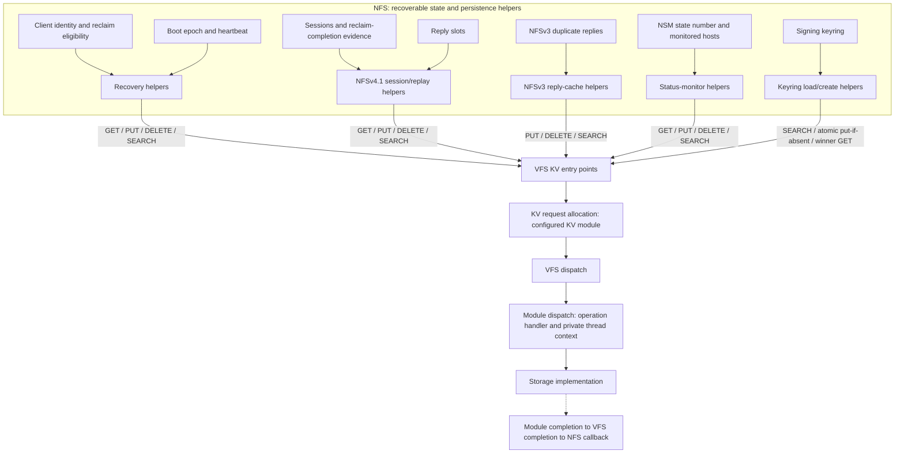
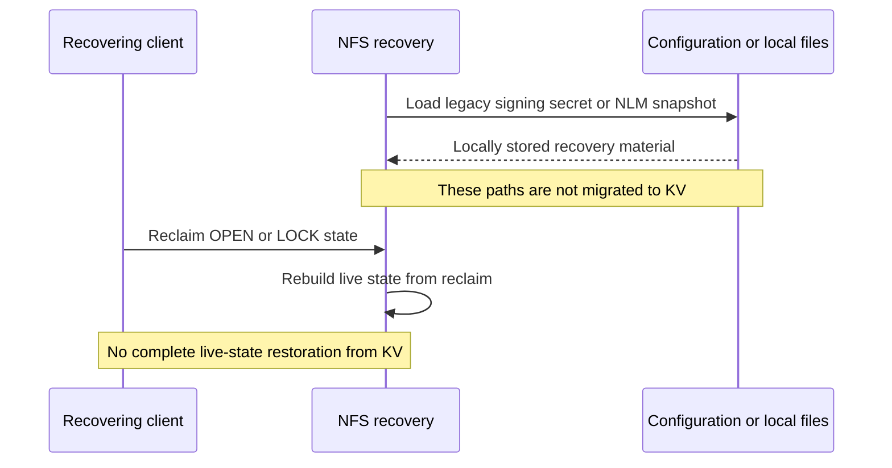
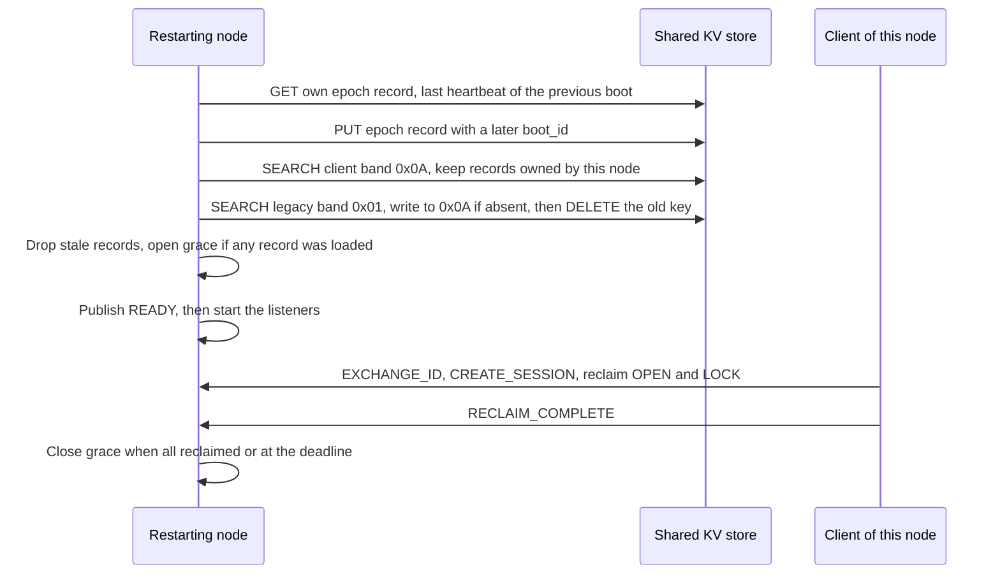
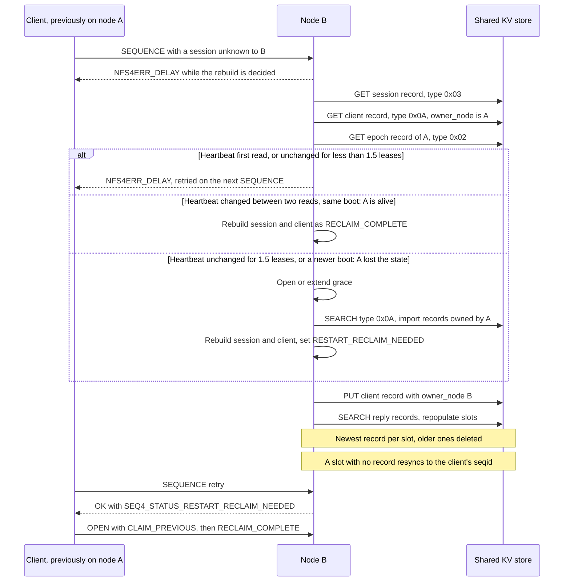

# NFS State Persistence, Recovery and Fleet Failover

This document describes how the NFS server persists protocol state through the
VFS key-value (KV) store, how that state is recovered after a restart, and how
an NFSv4.1 client fails over from a node that has died to another node in the
same fleet.

NFS stores persistent metadata through the VFS-supplied KV store. VFS routes
opaque KV requests; NFS owns record interpretation, recovery policy, signing,
key lifecycle, wire encoding, export resolution, authorization and responses.

## Summary

A 4.1 session and its reply cache are rebuilt from the KV store on whichever
node the client reconnects to. Two more pieces of state are fleet-wide, so that
a client can move from a node that has died:

1. **File-handle signing keyring.** Every node loads the same keyring from the
   KV store, so a handle signed by one node verifies on any other.
2. **Client recovery records.** There is one record per client, keyed by the
   client's owner, and its value names the node that owns the client. A node
   that rebuilds a client last owned by a dead or restarted peer imports that
   peer's records, opens grace and asks the client to reclaim.

A client that fails over from a dead node keeps its file handles and, apart
from the races described under
[Trade-offs and known limits](#trade-offs-and-known-limits), its right to
reclaim open and lock state. This holds only under the
[deployment prerequisites](#deployment-prerequisites).

## Deployment prerequisites

The code does not check these. They must be enforced by the deployment.

> **Required: identical export-to-ID mappings on every node.**
> A file handle carries an `export_id` and the VFS handle beneath it. Shared
> signing keys only make the handle *verifiable* on another node. The
> receiving node still resolves the `export_id` against its **own** export
> table. So every export must have the same `export_id` on every node, and
> must be served by the same VFS module over the same backend, so that the
> VFS handle names the same object. Either:
>
> - **pin `export_id` explicitly** for every export on every node
>   (recommended), or
> - guarantee identical export creation order and allocation history on every
>   node, because an omitted `export_id` is allocated locally, per node.
>
> A mismatch is not detected. A handle that crosses nodes is then either
> rejected as stale or resolved against the wrong export. Removing this
> prerequisite would need a coordinated, stable fleet-wide export-ID
> assignment (for example, held in the KV store).

- **One shared KV store, and a unique, pinned `node_id` per node.** The
  `node_id` decides record ownership and the key of each node's epoch record.
  Set it with `nfs4_node_id`. Without it, the node derives an id by hashing
  the machine name, which includes the hostname, the machine id and the
  Chimera version, so an upgrade or a hostname change gives the node a new id.
  The node then finds neither its legacy `0x01` records nor its own `0x0A`
  records, and its own records look to it like a dead peer's. A node logs a
  message at startup when it persists client recovery under a derived id.
- **External fencing of a node that is taken over.** Peer liveness is a
  heartbeat timeout. It detects a suspected failure but does not fence the old
  owner. If node A pauses, loses the KV store, or fails its heartbeat writes
  for more than 1.5 leases, node B takes A's clients over; when A resumes,
  nothing stops A from serving those clients or from re-persisting
  `owner_node = A` over B's records. A logs failed heartbeat and record
  writes, but keeps serving. The deployment must fence a node no later than
  1.5 leases after its last heartbeat: stop it, or cut it off from both
  clients and the KV store. Without external fencing, takeover would need an
  ownership generation enforced on every client operation and record write,
  and there is none.
- **One lease time across the fleet** (see [Grace and timing](#grace-and-timing)).
  Clocks are not compared across nodes.
- **A KV store whose completions are durable enough for recovery** (see
  [Module integration](#module-integration)).
- **A KV store that only the daemon can read.** The store holds the
  file-handle signing keys in cleartext. Anyone who can read them can mint
  valid handles for any export. The sqlite module makes its database files
  0600 and cairn makes its stores 0700; any other store, and a store shared
  over the network, must be protected by the deployment.

## Storage boundary

| Piece | Responsibility | Enables |
|---|---|---|
| Module SDK | KV operations and atomic put-if-absent | Supply replaceable record storage |
| VFS | Route requests to the configured KV module | Keep storage implementation behind module dispatch |
| NFS helpers | Encode records and load recovery evidence | Keep protocol decisions and signing in NFS |
| KV dispatch | GET, PUT, atomic put-if-absent, DELETE and SEARCH | Store opaque protocol records through module operations |

KV support identifies available operations, not a durability promise.
Persistence depends on the configured store's completion semantics.
Independent KV calls do not provide conditional updates, ownership exclusion or
a snapshot spanning requests.

## Persisted state and KV records

Every key starts with a 3-byte header (namespace, version `0x02`, record type).
NFS uses reserved, versioned, typed key namespaces, separate from other
protocol metadata and module-scoped fallback records. Modules sharing a store
must preserve these reservations and use unique module identifiers. Exact key
equality is required; namespace separation cannot compensate for hash
collisions.

| Type | Scope | Key tail | Value | Recovery purpose | Notes |
|---|---|---|---|---|---|
| `0x01` | node | `node_id`, owner | `NFR1` / `NFR2` | Legacy client identity and reclaim eligibility | Legacy: read and moved to `0x0A` once at cold start |
| `0x02` | node | `node_id` | `EPF1`: boot_id, written_at | Boot epoch and heartbeat; the previous boot's last heartbeat also ages NSM monitor records | Also read by peers to check liveness |
| `0x03` | client | sessionid | `NSS1` | NFSv4.1 session identity and reclaim-completion evidence | `flags` carries the reclaim-complete bit |
| `0x04` | client | sessionid, slot, seqid | `NRP2` | NFSv4.1 reply slots for replay | The rebuild keeps each slot's newest record; an unreplayable one keeps only its seqid |
| `0x05` | client | client | reply | NFSv3 duplicate-request replies | — |
| `0x06` | singleton | fixed sub-id | state number | NSM state number | — |
| `0x07` | node | `node_id`, host | `NSMM`: flags, peer address, renewal stamp | NSM monitored hosts of the node that granted their NLM locks | Not imported on failover |
| `0x08` | — | — | — | Former NFSv4.0 reply band; no longer written or read | — |
| `0x09` | fleet | kid | magic, state, kid, key, created_ns | Shared file-handle signing keyring | No `node_id` in the key |
| `0x0A` | fleet | owner | `NFR3` = `NFR2` + `owner_node` | Confirmed-client identity and reclaim eligibility | The value's `boot_id` is the boot of the node that wrote it |

### KV call paths

The [recovery](../../src/server/nfs/nfs4_recovery.c),
[session/replay](../../src/server/nfs/nfs4_drc.c),
[duplicate-reply](../../src/server/nfs/nfs3_drc.c),
[status-monitor](../../src/server/nfs/nfs_nsm.c) and
[keyring](../../src/server/nfs/nfs_fh_keyring.c) helpers encode records and
issue KV calls at the NFS/VFS boundary. Key layouts are defined in
[nfs_kv_keys.h](../../src/server/nfs/nfs_kv_keys.h).
[Request allocation and dispatch](../../src/vfs/vfs_internal.h) select the
configured KV module directly, without file-handle routing. Completion returns
results to the issuing NFS helper; these calls do not query a generic
persistence guarantee.

### State outside KV

- The legacy (V1) file-handle secret still uses configuration or a local key
  file. The first keyring key, `kid=1`, is derived from it. Eliminating
  local storage requires a compatible KV migration.
- Confirmed NLM lock snapshots still use local files and require a separate KV
  migration.
- Complete live OPEN, LOCK, share and delegation state is not restored from KV.
  Clients rebuild it by reclaim; transparent restoration would need additional
  stable descriptions.
- Connection-scoped reply caches and transient request/worker objects are not
  persistence targets.

## Module integration

| Module | Storage behavior | Effect |
|---|---|---|
| [In-memory KV](../../src/vfs/memkv/memkv.c) | Volatile | Client recovery disables persistence; the keyring derives `kid=1` from the node key |
| [Block-based filesystem](../../src/vfs/diskfs/diskfs.c) | KV entries are volatile despite persistent file data | Keyring uses local-key derivation; client recovery does not exclude this store |
| [Embedded SQL KV](../../src/vfs/sqlite/sqlite.c) | WAL with NORMAL synchronization; database and `-wal`/`-shm` files made 0600 at open | Reopening can retain records; successful commits need not survive power loss |
| [Persistent filesystem KV](../../src/vfs/cairn/cairn.c) | Synchronous metadata commits; `meta` and `data` stores made 0700 at open | Supplies persistent KV without an additional capability declaration |
| Other filesystem modules | Use the separately selected KV module | Recovery records follow that module's storage semantics |

The [SQL synchronization contract](https://www.sqlite.org/pragma.html#pragma_synchronous)
distinguishes ordinary reopening from power-loss durability. KV availability
alone establishes neither.

Out-of-tree KV modules use the current SDK (`CHIMERA_VFS_SDK_VERSION` 5) and
existing registration, configuration, private context and dispatch interfaces.
Implement GET, PUT, DELETE, ordered SEARCH and atomic put-if-absent
(`CHIMERA_VFS_PUT_KEY_IF_ABSENT`) with one winner across all writers sharing
the store. Preserve reserved namespaces, exact keys, value bytes, bounded
buffers, completion lifetimes and error distinctions. Verify competing
creators, reopening, failed writes and shutdown with pending operations. NFS
currently infers persistence using backend names; replacement stores require
review of those loader decisions as well as their actual durability semantics.

## Fleet-wide state

| Area | Behavior |
|---|---|
| FH signing key | A keyring in the KV store (type `0x09`, no `node_id` in the key) that every node loads at startup. The first start stores `kid=1` with an atomic put-if-absent, so exactly one candidate is stored and the others adopt it. The candidate is derived from the node key (`nfs_fh_key` config, else `state_dir/nfs_fh.key`, else a random persisted key), so a shared store needs no configuration, nodes with their own stores agree when they share a configured `nfs_fh_key`, and a recreated store gets the same key back. |
| FH wire format | V2 `0xC8`–`0xCF`: the tag carries the **kid** (1–8) in its low three bits, then export_id, VFS FH, SipHash-2-4 MAC. It is the same size as the node-key V1 format (`0xC6`, max 75 bytes), so a maximal named-stream handle still fits the 47-byte budget a proxying chimera can re-embed (static assert). New handles are V2; V1 handles are still accepted with the node key. |
| Key rotation | The ring has one slot per kid. Signing uses the newest ACTIVE kid; verification accepts ACTIVE or RETIRED kids. There is no tooling to add a kid and the ring is loaded only at startup, so only `kid=1` is written. A handle whose kid this node does not hold gets `NFS4ERR_BADHANDLE`. |
| Recovery record key | `[hdr][0x0A][owner]`, fleet-wide, with `owner_node` and the writer's `boot_id` in the value. |
| Cold start | Scans the `0x0A` band and keeps the records whose `owner_node` is this node; moves any records left in its own legacy `0x01` band to `0x0A` with put-if-absent, never over a record a peer holds, and deletes each legacy key only once its fleet record exists. |
| Record deletion | Only if the stored owner is still the expected node: on forget, at the end of grace, and in the stale purge. The end-of-grace and stale purges also require the same `boot_id`. |
| Peer liveness | Each node rewrites its epoch record every half lease, and peers read it; see [Grace and timing](#grace-and-timing). While the result is open, the client is held with `NFS4ERR_DELAY` and nothing is rebuilt or persisted. |
| Rebuilt 4.1 client | Marked RECLAIM_COMPLETE, unless the client's last owner is a **dead or restarted peer**; then the client is asked to reclaim. Not rebuilt if its lease was cancelled, or if a newer record holds its owner: the session record is deleted. |
| Session record bounds | The slot count and cached-reply cap read back from a session record are clamped to what CREATE_SESSION grants (`nfs4_session_slots`, default 256; 64 KiB), and a reply record whose length overruns its value is refused. |
| Unreplayable reply record | An empty or oversized record, or one whose bytes cannot be allocated, keeps only its seqid (COMPLETED), so a retransmit is an uncached retry. A failed resend is also an uncached retry. |
| Reply records of one slot | Keys hold the seqid little-endian, so the rebuild scan does not meet a slot's records in seqid order. While the scan runs, the newest record wins (wrap-aware) and the one it replaces is deleted. A record whose bytes were refused still pins its seqid against an older one. After the scan, a record only fills a slot that is still waiting to resync. A slot with no record resyncs to the client's seqid. |
| `eir_sequenceid` | EXCHANGE_ID returns the record's next CREATE_SESSION sequence. |

## End-to-end recovery

### Same-node restart

A restarting node reloads the clients it owned and opens a grace window for
them before it accepts connections. A client that returns to the same node
reclaims there; the cold start loads only the records this node owns.

A record is stale when its last renewal is more than 1.5 leases older than the
previous boot's last heartbeat; it is deleted only if the same owner and boot
still hold it. The NSM cold start ages this node's monitor records
(`0x07`) against the same heartbeat and notifies the hosts that remain.

### Failover to another node

Sessions are rebuilt lazily, on the first request that names an unknown
sessionid.

The whole decision is made before the rebuild is marked done. Until then the
client only sees `NFS4ERR_DELAY`, so it never sees a half-decided state. Each
peer is imported once per boot of that peer. When the peer restarted rather
than died, only the records written by its earlier boots are imported.

Client-visible outcomes:

| Situation | Client sees |
|---|---|
| Decision still open (heartbeat not yet seen to change or to stop, or a store error) | `NFS4ERR_DELAY` on SEQUENCE and BIND_CONN_TO_SESSION |
| Old node alive | Session restored, no reclaim requested |
| Old node dead or restarted | Session restored with `SEQ4_STATUS_RESTART_RECLAIM_NEEDED`; CLAIM_PREVIOUS accepted during grace |
| Decision still open after 2 leases | Session rebuilt without failover; an error is logged |
| Reply records unreadable | Session stays gated and its replies are rescanned; after 2 leases it is served with the replies that loaded |
| Client's lease was cancelled, or a newer record holds its owner | Session not rebuilt and its record deleted: `NFS4ERR_BADSESSION`, client re-establishes |
| No session record | Session unknown: `NFS4ERR_BADSESSION`, client re-establishes |

### Reclaim-completion evidence

A rebuilt client is marked RECLAIM_COMPLETE by default, because one that never
sends RECLAIM_COMPLETE would otherwise have its non-reclaim OPENs refused by
the per-client gate for the life of the mount. A failed-over client needs
evidence instead, kept on the session record:

- A global RECLAIM_COMPLETE on a persisted session sets
  `NFS4_DRC_SESSION_RECLAIM_COMPLETE` (`0x80000000`, outside the
  `CREATE_SESSION4_FLAG_*` range) on that session record, by
  read-modify-write, and then marks the client complete and answers
  `NFS4_OK`. If the store cannot be read or written, the failure is logged
  with the clientid and the client is still marked complete here: the bit
  only spares a later failover a second RECLAIM_COMPLETE, which
  `SEQ4_STATUS_RESTART_RECLAIM_NEEDED` asks for anyway. A session with no
  usable record has nothing to mark. A record rewritten after its session was
  destroyed is deleted again.
- CREATE_SESSION sets the same bit for a client that owes no RECLAIM_COMPLETE.
- A failed-over client whose session record carries the bit is marked
  `nfs4_client_recovered`: its CLAIM_PREVIOUS is still accepted, but its
  non-reclaim OPENs are not held back waiting for a second RECLAIM_COMPLETE.
- Failover marking happens once per client, so a later session's rebuild does
  not undo a completed reclaim.

## Grace and timing

| Item | Rule |
|---|---|
| Heartbeat | Each node rewrites its epoch record every half lease. A failed write is logged, at most once per half lease, and counted |
| Peer liveness clock | This node's monotonic clock only. The peer's `written_at` is compared for change, never with this node's time |
| Peer dead | Heartbeat unchanged for 1.5 leases (three missed beats) since this node first read it, or no epoch record |
| Peer alive | Heartbeat changed since a read made less than 1.5 leases earlier, and made after the client's first request here, from the boot that wrote the client's record. A read made before that cannot prove it: the peer may have written its final beat in between |
| Peer restarted | Heartbeat from a later boot than the one that wrote the client's record: that boot's clients fail over at once |
| Stale on import | A record is judged stale only against the heartbeat of the boot that wrote it, both stamped by that node's own wall clock. Records of a peer's earlier boots are never judged stale here, however long the peer took to restart: that boot's last heartbeat is no longer on record, and the later boot's cold start already purged the stale ones |
| Undecided | Unreadable records, or a heartbeat first read or unchanged for less than 1.5 leases: retried on each client request, for up to 2 leases |
| Grace on cold start | Opened for `grace_time_s` only if records were loaded |
| Grace on import | Opened (or extended) before the scan, then extended to `grace_time_s` from the end of the scan if anything was imported |
| Blocked during grace | Non-reclaim OPEN, READ, WRITE and LOCK get `NFS4ERR_GRACE`, for this node's own clients too |
| Imported clients that moved | Every half lease during grace, the records of imported clients still owed a reclaim are re-read; one now owned by a third node is owed nothing here |
| Grace closure | When nobody is owed a reclaim and no import is in flight, or at the deadline; unreclaimed records are then deleted if the same owner and boot still hold them |

All nodes need the same lease time. A client whose node died long before it
reconnects still waits 1.5 leases from its first request, while the new node
watches the dead node's heartbeat.

## Compatibility and migration

- **VFS SDK:** put-if-absent is `put_key.flags` with
  `CHIMERA_VFS_PUT_KEY_IF_ABSENT`, in `CHIMERA_VFS_SDK_VERSION` 5.
  Registration refuses a module built against another SDK version. A KV module
  must honour the flag atomically: if it ignored the flag, racing nodes could
  each overwrite the signing key and each report success.
- **Handles:** V1 handles that clients already hold keep verifying with the
  node key; new handles are V2. A build without the keyring verifies only V1
  handles, so a fleet should be upgraded as a unit.
- **Records:** `NFR1`/`NFR2` values still parse. Each node moves its own
  `0x01` records to `0x0A` on its first start, except for a client a peer
  already holds a `0x0A` record for. A record written to `0x0A` is
  not visible to an older build, so a downgrade loses reclaim for the clients
  persisted after the upgrade.
- **Volatile stores:** with memkv, recovery is off and the keyring derives
  `kid=1` from the node key, so a node's own handles survive its restart. The
  keyring does the same with `kv_module=diskfs`.
- **Per-node stores:** nodes that each have their own KV store (a sqlite file
  or a local cairn) still need the same `nfs_fh_key` to verify each other's
  handles, as before. With it they derive the same `kid=1`.
- **Outside failover:** same-node restart and moves away from a live node do
  not ask for reclaim; 4.1 answers `NFS4ERR_BAD_STATEID` for an unknown
  stateid; sessions are rebuilt lazily, per session; NFSv4.0 is not covered
  by failover.

## Trade-offs and known limits

- **The surviving node enters grace.** Importing a dead peer's records opens
  or extends grace on the importing node, so its own clients also get
  `NFS4ERR_GRACE` on non-reclaim operations until the imported clients have
  reclaimed or the window ends. If the import finds nobody to reclaim, the
  window closes as soon as it settles. With several survivors, the dead
  peer's clients split between them, and each survivor imports all of them.
  The window can still close early: every half lease during grace, a
  survivor re-reads the records of the imported clients it is still owed, and
  retires each one another survivor now owns. A client that comes back to no
  survivor still holds every survivor's window open until its deadline.
- **Conditional delete is read-then-delete, not atomic, and can lose a
  client's right to reclaim.** Node A reads the record as owned by A; node B
  takes the client over and writes `owner_node = B`; A's delete then removes
  B's record. B's half-lease refresh normally writes it back, but if B crashes
  first, the next recovery finds no record: CLAIM_PREVIOUS gets
  `NFS4ERR_RECLAIM_BAD` during grace, or `NFS4ERR_NO_GRACE` if no grace window
  is opened. Closing this needs an atomic compare-and-delete in the KV
  interface.
- **A former owner that is still alive keeps refreshing the record, for at
  most one lease.** After a client moves from a live node A to node B, A's
  half-lease refresh writes `owner_node = A` back until the client's lease
  expires on A, at most one lease after its last request there. The client
  then becomes a courtesy client on A, which can last up to a day, and A no
  longer refreshes its record. B's refresh restores it within half a lease.
  Should B die while A's write is the latest, the client is treated as A's,
  which is alive, so it is not asked to reclaim. Fencing these writes needs
  an atomic compare-and-put.
- **Liveness is a heartbeat, not proof that the old owner has stopped.** A
  node whose heartbeat writes fail keeps serving: it logs the failures, at
  most once per half lease, and counts them, but peers take its clients over
  1.5 leases after its heartbeat stops changing. The
  [fencing prerequisite](#deployment-prerequisites) covers that window. No
  clock is compared across nodes: a peer's heartbeat is only compared with
  its previous value, timed by the reader's monotonic clock, and a record's
  renewal stamp only with its own writer's heartbeat. A wall-clock step on a
  single node can still make its own records look fresher or staler than
  they are.
- **A client that moves off a live node waits** up to half a lease for the old
  node's next heartbeat; after a crash, 1.5 leases from the first request
  that makes the new node read the dead node's heartbeat.
- **Failback to a node that still holds the session is not detected.**
  Failover is detected only when a session is rebuilt from the KV store.
  Client X moves from node B to node A while B is alive, and B keeps X's
  session and client as courtesy state, for up to a day. If A then dies and X
  returns to B, B finds the session in memory and never reads the owner of X's
  record. X is not asked to reclaim the state it held on A, and B's slot table
  still holds the seqids from before X left, so a SEQUENCE on a slot X used on
  A gets `NFS4ERR_SEQ_MISORDERED`. A possible fix: when a half-lease refresh or
  a lookup finds the client's record owned by another node, drop the local
  session and client, so a returning client rebuilds them from the KV store.
- **Import cost.** Cold start and each first import from a given peer boot
  scan the whole `0x0A` band, which grows with the number of clients across
  the fleet.
- **Evidence is per session.** A client that sent RECLAIM_COMPLETE on a
  different session than the one being rebuilt is asked for another one.
- **A failing store loses reclaim-completion evidence, not service.**
  RECLAIM_COMPLETE is answered `NFS4_OK` even when the session record cannot
  be updated, so new mounts can open files while the store is failing. The
  cost comes later: if that client fails over, it is asked for
  RECLAIM_COMPLETE again, and its non-reclaim OPENs wait for it.
- **The signing keys are stored in cleartext.** Anyone who can read the KV
  store can mint a valid handle for any export. The sqlite module makes its
  files 0600 and cairn makes its stores 0700 when they are opened. Backups,
  network-shared stores and other KV modules must be protected by the
  deployment. Keys are not encrypted at rest.
- **The failover sequence is not tested end to end.** Unit tests cover each
  step against a shared memkv store: the keyring, record loading and
  migration, the liveness verdict, the import, the session rebuild with its
  reclaim marking, and the reply-slot rebuild. No test runs two servers and a
  client through the whole sequence: SEQUENCE on an unknown session, the
  rebuild and import, `SEQ4_STATUS_RESTART_RECLAIM_NEEDED`, OPEN with
  CLAIM_PREVIOUS, then RECLAIM_COMPLETE.
- **NFSv4.0 is not covered.** The import is triggered only by a 4.1 session
  rebuild.
- **NFSv3 locking is not covered.** NSM monitor records (`0x07`) are scoped to
  the node that granted the NLM locks and are not imported, and confirmed NLM
  lock snapshots are local files. Another node does not notify a dead node's
  NLM clients or rebuild their locks.
- **Sharded KV backends.** No key hash tags are added, so the multi-key scans
  assume one keyspace.
