# NFS State Persistence, Recovery and Fleet Failover

This document describes how the NFS server persists protocol state through the
VFS key-value (KV) store, how that state is recovered after a restart, and how
an NFSv4.1 client fails over from a node that has died to another node in the
same fleet.

NFS stores persistent metadata through the VFS-supplied KV store. VFS routes
opaque KV requests; NFS owns record interpretation, recovery policy, signing,
key lifecycle, wire encoding, export resolution, authorization and responses.

## Summary

Upstream already rebuilds a 4.1 session and its reply cache on whichever node
the client reconnects to. Two pieces were still node-local:

1. **File-handle signing key.** A handle signed by node A fails verification on
   node B unless an operator configured the same `nfs_fh_key` on every node.
2. **Client recovery records.** They were keyed by the node that minted them,
   so only that node could open a grace window for its clients. A client that
   failed over found no record on the new node, and its rebuilt client was
   marked RECLAIM_COMPLETE, so CLAIM_PREVIOUS was answered
   `NO_GRACE`.

The series makes both fleet-wide. A client that fails over from a dead node
keeps its file handles and, apart from the race described under
[Trade-offs and known limits](#trade-offs-and-known-limits), its right to
reclaim open and lock state. This holds only under the
[deployment prerequisites](#deployment-prerequisites). The series also fixes
two bugs that this path exposes.

## Deployment prerequisites

The code does not check these. They must be enforced by the deployment.

> **Required: identical export-to-ID mappings on every node.**
> A file handle carries an `export_id` and the VFS handle beneath it. Shared
> signing keys only make the handle *verifiable* on another node. The
> receiving node still resolves the `export_id` against its **own** export
> table. So every export must have the same `export_id` on every node, and
> must be served by the same VFS module over the same backend, so that the
> VFS handle names the same object. Either:
>
> - **pin `export_id` explicitly** for every export on every node
>   (recommended), or
> - guarantee identical export creation order and allocation history on every
>   node, because an omitted `export_id` is allocated locally, per node.
>
> A mismatch is not detected. A handle that crosses nodes is then either
> rejected as stale or resolved against the wrong export. Removing this
> prerequisite would need a coordinated, stable fleet-wide export-ID
> assignment (for example, held in the KV store).

- **One shared KV store, and a unique `node_id` per node.** The `node_id`
  decides record ownership and the key of each node's epoch record.
- **External fencing of a node that is taken over.** Peer liveness is a
  heartbeat timeout. It detects a suspected failure but does not fence the old
  owner. If node A pauses, or loses the KV store, for more than 1.5 leases,
  node B takes A's clients over; when A resumes, nothing stops A from serving
  those clients or from re-persisting `owner_node = A` over B's records. The
  deployment must fence a node no later than 1.5 leases after its last
  heartbeat: stop it, or cut it off from both clients and the KV store.
  Without external fencing, takeover would need an ownership generation
  enforced on every client operation and record write; the series has none.
- **Roughly synchronised clocks and one lease time** across the fleet (see
  [Grace and timing](#grace-and-timing)).
- **A KV store whose completions are durable enough for recovery** (see
  [Module integration](#module-integration)).

## Storage boundary

| Piece | Responsibility | Enables |
|---|---|---|
| Module SDK | KV operations and atomic put-if-absent | Supply replaceable record storage |
| VFS | Route requests to the configured KV module | Keep storage implementation behind module dispatch |
| NFS helpers | Encode records and load recovery evidence | Keep protocol decisions and signing in NFS |
| KV dispatch | GET, PUT, atomic put-if-absent, DELETE and SEARCH | Store opaque protocol records through module operations |

KV support identifies available operations, not a durability promise.
Persistence depends on the configured store's completion semantics.
Independent KV calls do not provide conditional updates, ownership exclusion or
a snapshot spanning requests.

## Persisted state and KV records

Every key starts with a 3-byte header (namespace, version `0x02`, record type).
NFS uses reserved, versioned, typed key namespaces, separate from other
protocol metadata and module-scoped fallback records. Modules sharing a store
must preserve these reservations and use unique module identifiers. Exact key
equality is required; namespace separation cannot compensate for hash
collisions.

| Type | Scope | Key tail | Value | Recovery purpose | Changed by the series |
|---|---|---|---|---|---|
| `0x01` | node | `node_id`, owner | `NFR1` / `NFR2` | Legacy client identity and reclaim eligibility | **Legacy:** read and migrated to `0x0A` once at cold start |
| `0x02` | node | `node_id` | `EPF1`: boot_id, written_at | Boot epoch and heartbeat; the previous boot's last heartbeat also ages NSM monitor records | Now also read by peers to check liveness |
| `0x03` | client | sessionid | `NSS1` | NFSv4.1 session identity and reclaim-completion evidence | `flags` gains the reclaim-complete bit |
| `0x04` | client | sessionid, slot, seqid | `NRP2` | NFSv4.1 reply slots for replay | The rebuild keeps each slot's newest record; an unreplayable one keeps only its seqid |
| `0x05` | client | client | reply | NFSv3 duplicate-request replies | — |
| `0x06` | singleton | fixed sub-id | state number | NSM state number | — |
| `0x07` | node | `node_id`, host | `NSMM`: flags, peer address, renewal stamp | NSM monitored hosts of the node that granted their NLM locks | — (not imported on failover) |
| `0x08` | — | — | — | Former NFSv4.0 reply band; no longer written or read | — |
| `0x09` | fleet | kid | magic, state, kid, key, created_ns | Shared file-handle signing keyring | **New** |
| `0x0A` | fleet | owner | `NFR3` = `NFR2` + `owner_node` | Confirmed-client identity and reclaim eligibility | **New**: the value's `boot_id` is the boot of the node that wrote it |

### KV call paths

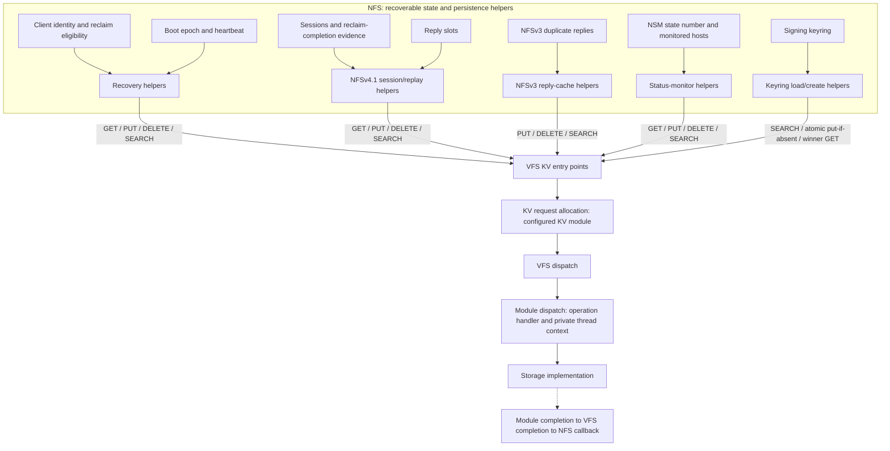

The [recovery](../../src/server/nfs/nfs4_recovery.c),
[session/replay](../../src/server/nfs/nfs4_drc.c),
[duplicate-reply](../../src/server/nfs/nfs3_drc.c),
[status-monitor](../../src/server/nfs/nfs_nsm.c) and
[keyring](../../src/server/nfs/nfs_fh_keyring.c) helpers encode records and
issue KV calls at the NFS/VFS boundary. Key layouts are defined in
[nfs_kv_keys.h](../../src/server/nfs/nfs_kv_keys.h).
[Request allocation and dispatch](../../src/vfs/vfs_internal.h) select the
configured KV module directly, without file-handle routing. Completion returns
results to the issuing NFS helper; these calls do not query a generic
persistence guarantee.

### State outside KV

- The legacy (V1) file-handle secret still uses configuration or a local key
  file. It also seeds `kid=1` when the store is not persistent. Eliminating
  local storage requires a compatible KV migration.
- Confirmed NLM lock snapshots still use local files and require a separate KV
  migration.
- Complete live OPEN, LOCK, share and delegation state is not restored from KV.
  Clients rebuild it by reclaim; transparent restoration would need additional
  stable descriptions.
- Connection-scoped reply caches and transient request/worker objects are not
  persistence targets.

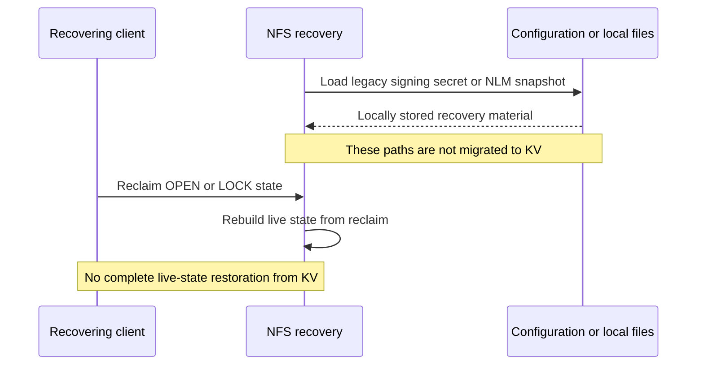

## Module integration

| Module | Storage behavior | Effect |
|---|---|---|
| [In-memory KV](../../src/vfs/memkv/memkv.c) | Volatile | Client recovery disables persistence; the keyring derives `kid=1` from the node key |
| [Block-based filesystem](../../src/vfs/diskfs/diskfs.c) | KV entries are volatile despite persistent file data | Keyring uses local-key derivation; client recovery does not exclude this store |
| [Embedded SQL KV](../../src/vfs/sqlite/sqlite.c) | WAL with NORMAL synchronization | Reopening can retain records; successful commits need not survive power loss |
| [Persistent filesystem KV](../../src/vfs/cairn/cairn.c) | Synchronous metadata commits | Supplies persistent KV without an additional capability declaration |
| Other filesystem modules | Use the separately selected KV module | Recovery records follow that module's storage semantics |

The [SQL synchronization contract](https://www.sqlite.org/pragma.html#pragma_synchronous)
distinguishes ordinary reopening from power-loss durability. KV availability
alone establishes neither.

Out-of-tree KV modules use the current SDK (`CHIMERA_VFS_SDK_VERSION` 5) and
existing registration, configuration, private context and dispatch interfaces.
Implement GET, PUT, DELETE, ordered SEARCH and atomic put-if-absent
(`CHIMERA_VFS_PUT_KEY_IF_ABSENT`) with one winner across all writers sharing
the store. Preserve reserved namespaces, exact keys, value bytes, bounded
buffers, completion lifetimes and error distinctions. Verify competing
creators, reopening, failed writes and shutdown with pending operations. NFS
currently infers persistence using backend names; replacement stores require
review of those loader decisions as well as their actual durability semantics.

## What the series changes

| Area | Upstream | This series |
|---|---|---|
| FH signing key | One 128-bit key per node: `nfs_fh_key` config, else `state_dir/nfs_fh.key`, else a random persisted key. A fleet needs the same key on every node. | A keyring in the KV store (type `0x09`, no `node_id` in the key) that every node loads. The first start mints `kid=1` with an atomic put-if-absent, so exactly one node's key is stored and the others adopt it. No configuration is needed. |
| FH wire format | V1 `0xC6`: tag, export_id, VFS FH, SipHash-2-4 MAC. | V2 `0xC8`–`0xCF`: the tag carries the **kid** (1–8) in its low three bits, then export_id, VFS FH, MAC. Same size as V1 (max 75 bytes), so a maximal named-stream handle still fits the 47-byte budget a proxying chimera can re-embed (static assert). New handles are V2; V1 handles are still accepted with the node key. |
| Key rotation | Not possible without invalidating every handle. | The ring holds up to 8 kids. Signing uses the newest ACTIVE kid; verification accepts ACTIVE or RETIRED kids. Tooling to add a kid is not in this series, and the ring is loaded only at startup. |
| Recovery record key | `[hdr][0x01][node_id][owner]`, per node. | `[hdr][0x0A][owner]`, fleet-wide, with `owner_node` and the writer's `boot_id` in the value. |
| Cold start | Scans its own `0x01` band. | Scans the `0x0A` band and keeps the records whose `owner_node` is this node; moves any records left in its own `0x01` band to `0x0A`. |
| Record deletion | Unconditional delete of its own key. | Deletes only if the stored owner is still the expected node: on forget, at the end of grace, and in the stale purge. The end-of-grace and stale purges also require the same `boot_id`. |
| Peer liveness | Each node rewrites its epoch record every half lease, but only it reads it back. | Peers read each other's epoch records; see [Grace and timing](#grace-and-timing). While the result is open, the client is held with `NFS4ERR_DELAY` and nothing is rebuilt or persisted. |
| Rebuilt 4.1 client | Marked RECLAIM_COMPLETE. Not rebuilt if its lease was cancelled, or if a newer record holds its owner: the session record is deleted. | Same, unless the client's last owner is a **dead or restarted peer**; then the client is asked to reclaim. |
| Unreplayable reply record | Installed as CACHED if it fits the cap read from the session record, even when empty; a failed resend aborts the server. | An empty or oversized record, or one whose bytes cannot be allocated, keeps only its seqid (COMPLETED), so a retransmit is an uncached retry. A failed resend becomes an uncached retry instead of an abort. |
| Reply records of one slot | The first record the rebuild scan meets wins the slot and any other is deleted, even a newer one. Keys hold the seqid little-endian, so the scan order is not seqid order. A slot with no record resyncs to the client's seqid. | While the scan runs, the newest record wins (wrap-aware) and the one it replaces is deleted. A record whose bytes were refused still pins its seqid against an older one. After the scan, the upstream rule applies. |
| `eir_sequenceid` | Always 1. | The record's next CREATE_SESSION sequence. |

## End-to-end recovery

### Same-node restart

A restarting node reloads the clients it owned and opens a grace window for
them before it accepts connections. A client that returns to the same node
reclaims as before; this path is unchanged by the series apart from the
fleet-wide record band.

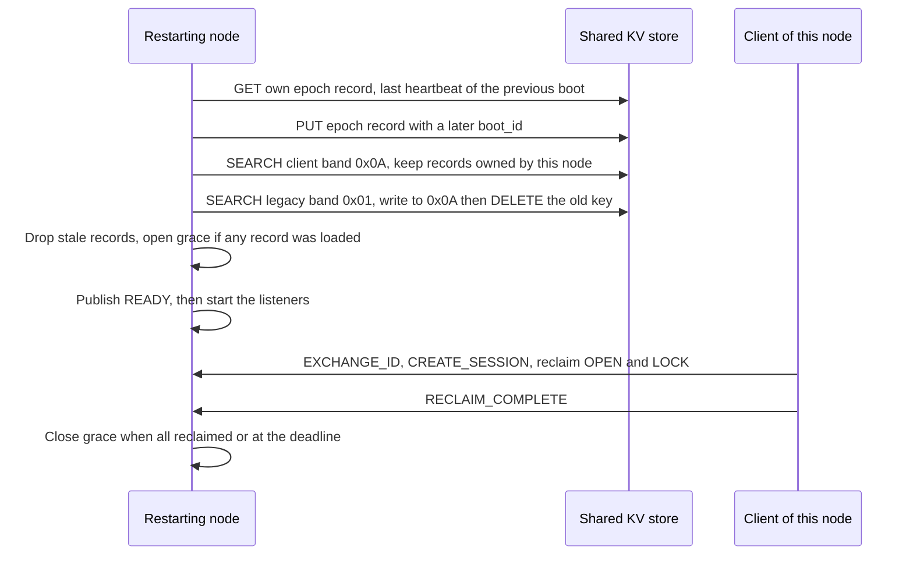

A record is stale when its last renewal is more than 1.5 leases older than the
previous boot's last heartbeat; it is deleted only if the same owner and boot
still hold it. Upstream's NSM cold start ages this node's monitor records
(`0x07`) against the same heartbeat and notifies the hosts that remain.

### Failover to another node

Sessions are rebuilt lazily, on the first request that names an unknown
sessionid.

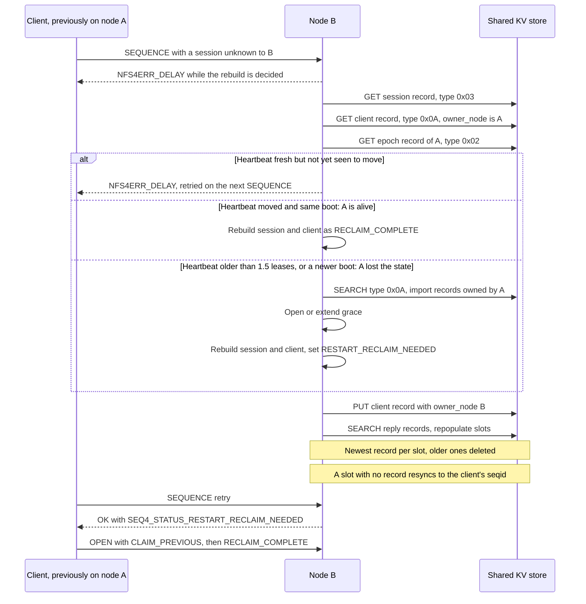

The whole decision is made before the rebuild is marked done. Until then the
client only sees `NFS4ERR_DELAY`, so it never sees a half-decided state. Each
peer is imported once per boot of that peer. When the peer restarted rather
than died, only the records written by its earlier boots are imported.

Client-visible outcomes:

| Situation | Client sees |
|---|---|
| Decision still open (fresh heartbeat not yet seen to move, or a store error) | `NFS4ERR_DELAY` on SEQUENCE and BIND_CONN_TO_SESSION |
| Old node alive | Session restored, no reclaim requested |
| Old node dead or restarted | Session restored with `SEQ4_STATUS_RESTART_RECLAIM_NEEDED`; CLAIM_PREVIOUS accepted during grace |
| Decision still open after 2 leases | Session rebuilt without failover; an error is logged |
| Reply records unreadable | Session stays gated and its replies are rescanned; after 2 leases it is served with the replies that loaded |
| Client's lease was cancelled, or a newer record holds its owner | Session not rebuilt and its record deleted: `NFS4ERR_BADSESSION`, client re-establishes |
| No session record | Session unknown: `NFS4ERR_BADSESSION`, client re-establishes |

### Reclaim-completion evidence

Upstream marks a rebuilt client RECLAIM_COMPLETE because one that never sends
RECLAIM_COMPLETE would otherwise have its non-reclaim OPENs refused by the
per-client gate for the life of the mount. The series keeps evidence on the
session record:

- A global RECLAIM_COMPLETE on a persisted session sets
  `NFS4_DRC_SESSION_RECLAIM_COMPLETE` (`0x80000000`, outside the
  `CREATE_SESSION4_FLAG_*` range) on that session record, by
  read-modify-write. The client is marked complete, and answered `NFS4_OK`,
  only once the bit is durable. If the store cannot be read or written, the
  answer is `NFS4ERR_DELAY` and nothing is marked. A session with no usable
  record has nothing to mark and completes at once. A record rewritten after
  its session was destroyed is deleted again.
- CREATE_SESSION sets the same bit for a client that owes no RECLAIM_COMPLETE.
- A failed-over client whose session record carries the bit is marked
  `nfs4_client_recovered`: its CLAIM_PREVIOUS is still accepted, but its
  non-reclaim OPENs are not held back waiting for a second RECLAIM_COMPLETE.
- Failover marking happens once per client, so a later session's rebuild does
  not undo a completed reclaim.

## Grace and timing

| Item | Rule |
|---|---|
| Heartbeat | Each node rewrites its epoch record every half lease (`written_at` is `CLOCK_REALTIME`) |
| Peer dead | Heartbeat more than 1.5 leases old (three missed beats), or no epoch record |
| Peer alive | Fresh heartbeat that has moved since this node last looked, from the boot that wrote the client's record |
| Peer restarted | Fresh heartbeat from a later boot than the one that wrote the client's record: treated as failover |
| Undecided | Unreadable records, or a fresh heartbeat not yet seen to move: retried on each client request, for up to 2 leases |
| Grace on cold start | Opened for `grace_time_s` only if records were loaded |
| Grace on import | Opened (or extended) before the scan, then extended to `grace_time_s` from the end of the scan if anything was imported |
| Blocked during grace | Non-reclaim OPEN, READ, WRITE and LOCK get `NFS4ERR_GRACE`, for this node's own clients too |
| Grace closure | When nobody is owed a reclaim and no import is in flight, or at the deadline; unreclaimed records are then deleted if the same owner and boot still hold them |

Nodes need roughly synchronised clocks (NTP), with skew well under half a
lease, and the same lease time.

## Compatibility and migration

- **VFS SDK:** 0001 adds `put_key.flags` and `CHIMERA_VFS_PUT_KEY_IF_ABSENT`
  and bumps `CHIMERA_VFS_SDK_VERSION` from 4 to 5. A module built against SDK 4
  is refused at registration. A KV module must honour the flag atomically: if
  it ignored the flag, racing nodes could each overwrite the signing key and
  each report success.
- **Handles:** V1 handles that clients already hold keep verifying with the
  node key; new handles are V2. A node running this series and a node running
  `main` cannot verify each other's new handles, so a fleet should be upgraded
  as a unit.
- **Records:** `NFR1`/`NFR2` values still parse. Each node moves its own
  `0x01` records to `0x0A` on its first start. A record written to `0x0A` is
  not visible to an older build, so a downgrade loses reclaim for the clients
  persisted after the upgrade.
- **Volatile stores:** with memkv, recovery is off and the keyring derives
  `kid=1` from the node key, so a node's own handles survive its restart. The
  keyring does the same with `kv_module=diskfs`.
- **Unchanged on purpose:** same-node restart and moves away from a live node
  behave as before; 4.1 still answers `NFS4ERR_BAD_STATEID` for an
  unknown stateid; sessions are still rebuilt lazily, per session; NFSv4.0 is
  not covered by failover.

## Trade-offs and known limits

- **The surviving node enters grace.** Importing a dead peer's records opens
  or extends grace on the importing node, so its own clients also get
  `NFS4ERR_GRACE` on non-reclaim operations until the imported clients have
  reclaimed or the window ends. If the import finds nobody to reclaim, the
  window closes as soon as it settles.
- **Conditional delete is read-then-delete, not atomic, and can lose a
  client's right to reclaim.** Node A reads the record as owned by A; node B
  takes the client over and writes `owner_node = B`; A's delete then removes
  B's record. B's half-lease refresh normally writes it back, but if B crashes
  first, the next recovery finds no record: CLAIM_PREVIOUS gets
  `NFS4ERR_RECLAIM_BAD` during grace, or `NFS4ERR_NO_GRACE` if no grace window
  is opened. Closing this needs an atomic compare-and-delete in the KV
  interface.
- **A former owner that is still alive keeps refreshing the record.** After a
  client moves from a live node A to node B, A's half-lease refresh writes
  `owner_node = A` back until the client's lease expires on A. B's refresh
  restores it within half a lease. Fencing these writes needs an atomic
  compare-and-put.
- **A client that moves off a live node waits** up to half a lease for the old
  node's next heartbeat; after a crash, until the heartbeat is 1.5 leases old.
- **Import cost.** Cold start and each first import from a given peer boot
  scan the whole `0x0A` band, which grows with the number of clients across
  the fleet.
- **Evidence is per session.** A client that sent RECLAIM_COMPLETE on a
  different session than the one being rebuilt is asked for another one.
- **NFSv4.0 is not covered.** The import is triggered only by a 4.1 session
  rebuild.
- **NFSv3 locking is not covered.** NSM monitor records (`0x07`) are scoped to
  the node that granted the NLM locks and are not imported, and confirmed NLM
  lock snapshots are local files. Another node does not notify a dead node's
  NLM clients or rebuild their locks.
- **Sharded KV backends.** No key hash tags are added, so the multi-key scans
  assume one keyspace.

## Recovery findings

First-key creation is protected by atomic put-if-absent: one creator wins and
competing creators read back its key. This protection applies to creation, not
subsequent record updates or deletion. Ordinary PUT is valid for replacement; a
race requires a conflicting writer or an intervening update.

| Area | Observed behavior | Assessment |
|---|---|---|
| [Storage classification](../../src/server/nfs/nfs4_recovery.c) and [keyring selection](../../src/server/nfs/nfs_fh_keyring.c) | Different backend-name checks determine persistence behavior | Volatile KV can be selected for recovery; backend support alone does not establish persistence |
| [SQL completion](../../src/vfs/sqlite/sqlite.c) | WAL commits use NORMAL synchronization | Acknowledged writes can be lost after power loss; not fault-injection tested |
| [First signing key](../../src/server/nfs/nfs_fh_keyring.c) | Atomic creation with winner readback | Creation race addressed; not an outstanding gap |
| [Recovery updates](../../src/server/nfs/nfs4_recovery.c) | Refresh uses ordinary PUT; deletion checks a record before a separate DELETE | Potential stale-writer overwrite or deletion of an intervening replacement; documented under [known limits](#trade-offs-and-known-limits), not reproduced |
| [Recovery loading](../../src/server/nfs/nfs4_recovery.c) | Finalization publishes ready even when store errors were recorded | Partial-load readiness is visible in code (logged as a store error); recovery consequences need fault injection |
| [Replay loading](../../src/server/nfs/nfs4_drc.c) | Retry expiry permits reconstruction despite uncertainty or completion with only some replies loaded | The 2-lease bound is deliberate (see [Grace and timing](#grace-and-timing)); replay-safety consequences are unverified |
| [Reclaim evidence](../../src/server/nfs/nfs4_drc.c) | Whole-record read/modify/PUT; malformed session records complete successfully without storing evidence | A corrupt record cannot be rebuilt on any node, so there is nothing to mark; lost updates require concurrency verification |
| [Keyring loading](../../src/server/nfs/nfs_fh_keyring.c) | Malformed entries are skipped | Incomplete-ring risk needs malformed-record testing; an unreadable existing first key causes startup rejection |
| [Keyring lifecycle](../../src/server/nfs/nfs_fh_keyring.c) | Ring loads at startup without live rotation or refresh | Scope limitation, not an established defect |
| [In-memory KV](../../src/vfs/memkv/memkv.c) and [filesystem KV cache](../../src/vfs/diskfs/diskfs_attr.c) | Hash-only identity; GET returns a borrowed value after unlocking | Collision aliasing and concurrent invalidation are potential failures; not reproduced |
| [Persistent filesystem KV reads](../../src/vfs/cairn/cairn.c) | Stored value length is copied without checking the request-buffer bound | Missing bound check is visible; an oversized-value failure is not reproduced |
| [Other handle-state consumers](../../src/vfs/vfs.c) | Fallback persistence eligibility checks only that KV is configured | Broader consumer-contract gap outside NFS; volatile-store recovery consequences are unverified |

### Finding sequences

The sequences distinguish implemented behavior from hypothetical failure
interleavings; they are explanations, not failure reproductions.

#### Storage classification: backend-name inference

The two loaders use different name exclusions. This is an observed
classification gap, not a generic storage guarantee.

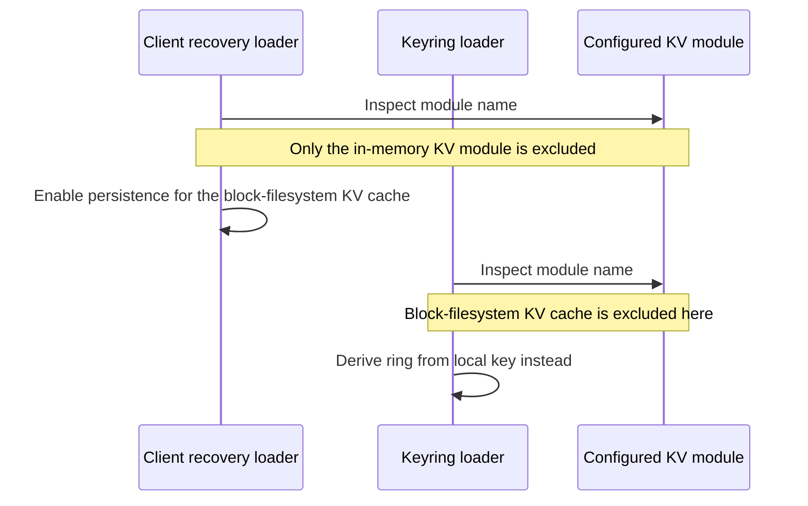

#### SQL completion: power-loss durability

This illustrates the documented synchronization limit; no power-loss failure
has been reproduced here.

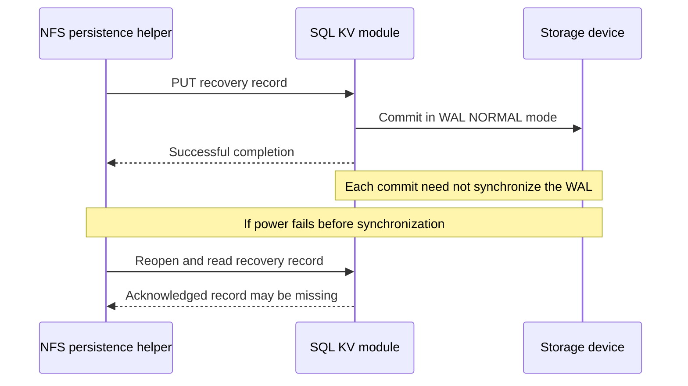

#### First-key creation: protected

Atomic creation prevents competing initial keys; this is not an outstanding
gap.

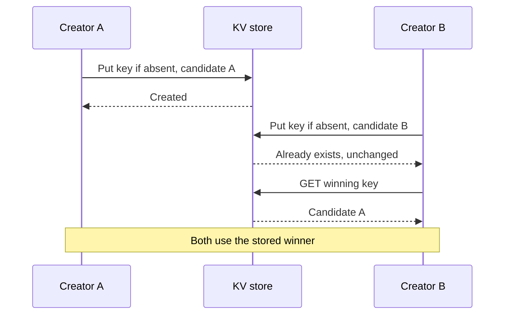

#### Recovery updates: potential interleavings

These scenarios require competing operations and have not been reproduced.
Periodic refresh can restore a deleted record but does not make deletion
atomic.

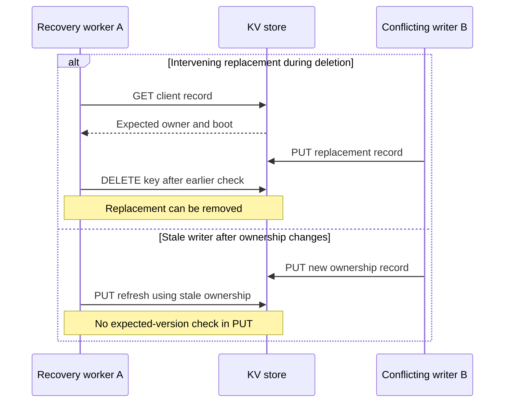

#### Recovery loading: partial readiness

The error and readiness paths are visible in code; client recovery
consequences need fault injection.

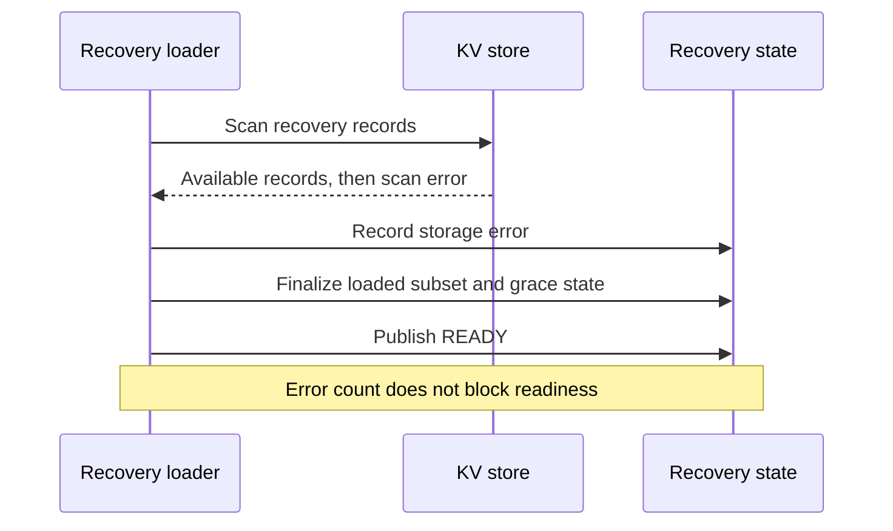

#### Replay loading: timeout fallback

Retries initially gate requests. The fallback paths below occur after the
retry window; their safety consequences are unverified.

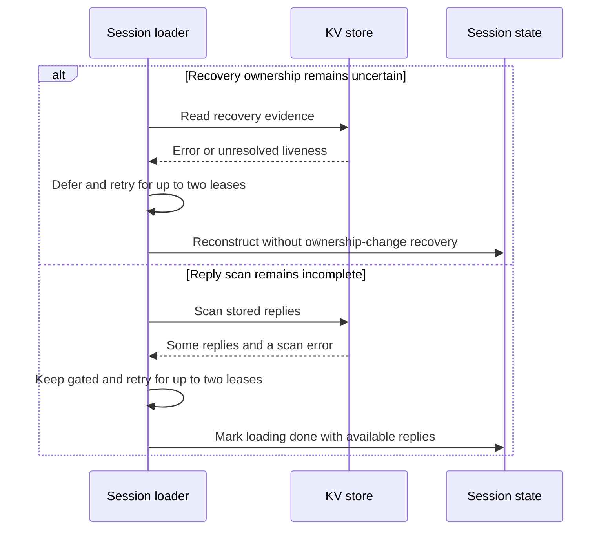

#### Reclaim evidence: update and malformed records

The lost-update example assumes a conflicting record writer and needs
verification. The malformed-record success path is directly observable.

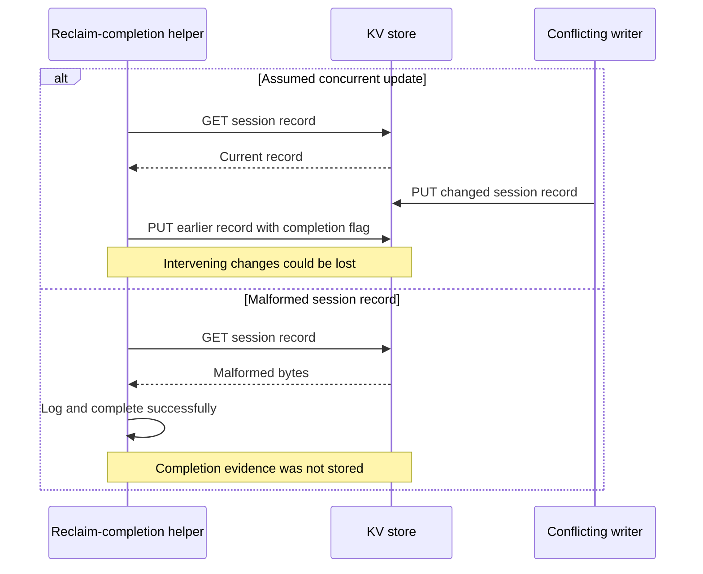

#### Keyring loading: skipped malformed entries

Malformed entries are skipped. This does not bypass first-key protection: an
existing unreadable first key causes startup rejection during winner readback.

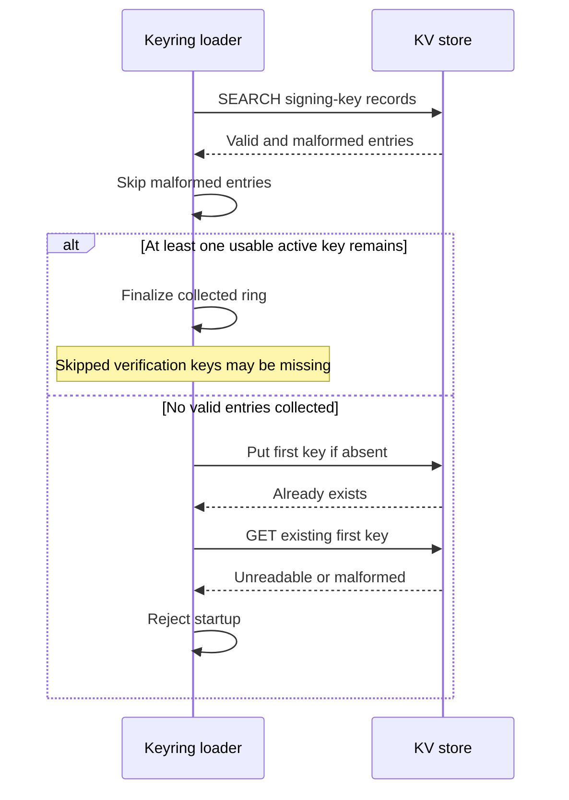

#### Keyring lifecycle: scope limitation

There is no live rotation/refresh mechanism. A change to stored keys is a
hypothetical trigger here, not an implemented maintenance operation.

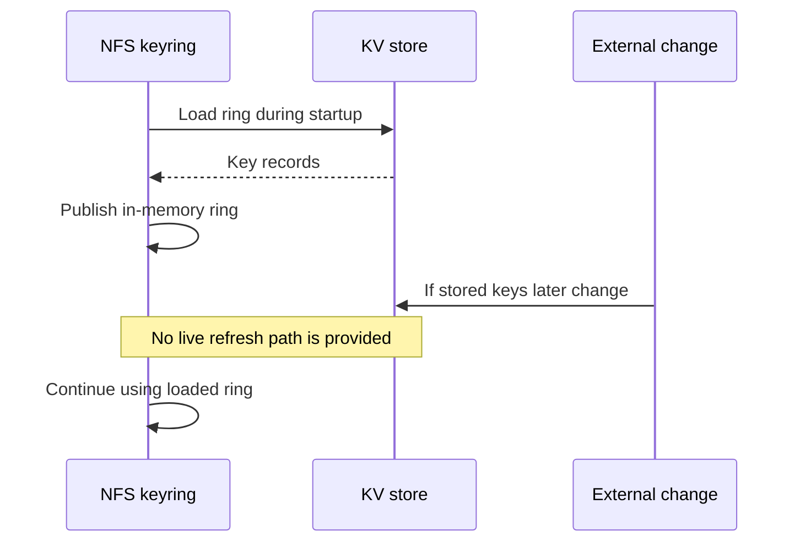

#### In-memory KV: identity and value lifetime

Hash collisions and concurrent replacement/deletion are separate potential
failure conditions; neither has been reproduced.

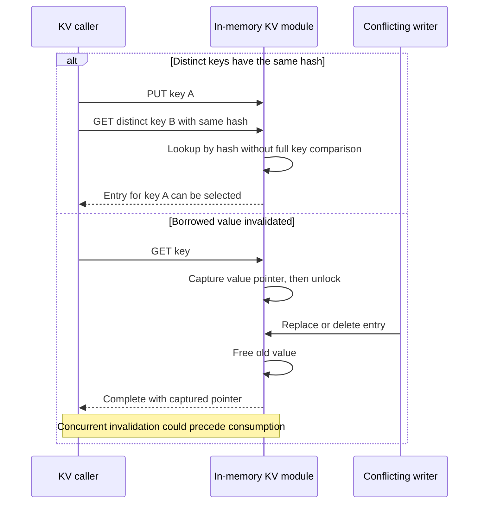

#### Persistent KV reads: missing size check

The copy lacks a destination-bound check. The scenario requires an oversized
stored value and has not been reproduced.

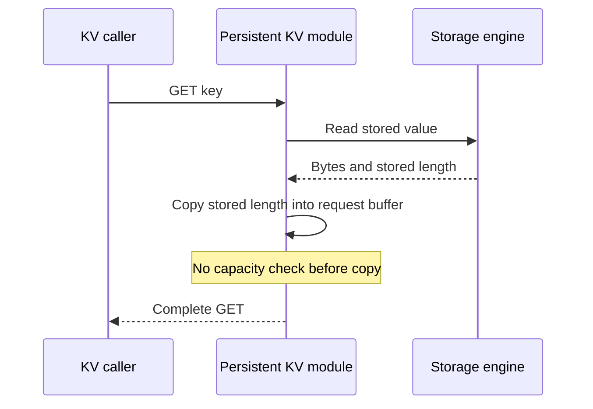

#### Other handle-state consumers: persistence eligibility

This fallback is outside NFS. Its configured-store check does not establish
durable storage; recovery consequences are unverified.

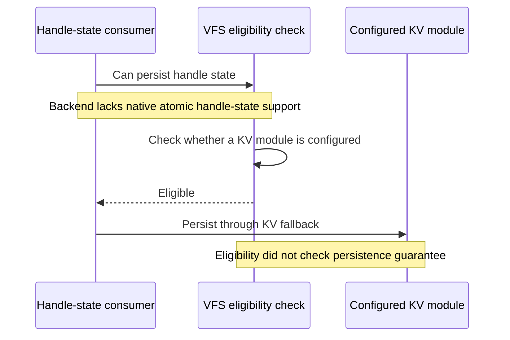

## Design coverage

The persistence document listed recovery-contract details it did not cover.
This table shows where the combined document now covers them and what remains.

| Area | Status |
|---|---|
| End-to-end recovery | **Covered:** [End-to-end recovery](#end-to-end-recovery), including client-visible outcomes |
| Recovery prerequisites | **Covered:** [Deployment prerequisites](#deployment-prerequisites) (export IDs, unique `node_id`, fencing, clocks, durable store) |
| Compatibility and migration | **Covered:** [Compatibility and migration](#compatibility-and-migration) |
| Protocol coverage | **Covered:** NFSv4.1 only, evidence per session, no transparent live-state restoration ([known limits](#trade-offs-and-known-limits)) |
| Grace and timing | **Covered:** [Grace and timing](#grace-and-timing) |
| Namespace and scans | **Partly covered:** record types and scan cost are listed; supported scan ordering and keyspace/sharding assumptions are not yet defined as limits |
| Verification evidence | **Remaining:** no requirement-to-test matrix or failure-injection results for concurrency, malformed records, failed storage operations and power loss |

## Patches

| # | Patch | Depends on |
|---|---|---|
| 0001 | vfs: add an atomic put-if-absent KV operation (memkv, sqlite, diskfs, cairn); bumps `CHIMERA_VFS_SDK_VERSION` to 5 | -- |
| 0002 | nfs: sign file handles with a fleet-wide keyring stored in the KV store | 0001 |
| 0003 | nfs: keep client recovery records in a fleet-wide band | -- |
| 0004 | nfs: ask a client that failed over from a dead node to reclaim | 0003 |
| 0005 | nfs: never abort on an unreplayable 4.1 reply cache entry, and keep each slot's newest reply record | 0004 |
| 0006 | nfs: return the next CREATE_SESSION sequence from EXCHANGE_ID | -- |

0006 is a standalone bug fix. 0005 relies on 0004 holding a session's
requests off with `NFS4ERR_DELAY` until its rebuild settles, so only the
rebuild scan moves a restored slot. 0002 and 0003/0004 are independent of
each other.

## Testing and verification

- **New tests:**
  - `test_fh_keyring`: key layout, the load without persistence, and two nodes
    sharing one memkv store where the second adopts the first's key and
    verifies its handles.
  - `test_nfs_failover`: two to four nodes sharing one memkv store; covers
    filtered loading, migration of legacy records, owner-checked forget and
    purge, importing only from a dead or restarted peer, and reclaim-complete
    persistence.
- **Extended tests:** `test_fh_security` (V2 cases), `test_protocol_advertise`,
  `vfs_kv_test` (put-if-absent) and `test_nfs_persist` (`NFR2` parsing,
  failover reclaim marking, unreplayable reply records, newest reply record per
  slot, EXCHANGE_ID sequence for a returning client). Upstream's
  `test_repopulate_only_fills_a_resync_slot` now expects an oversized record
  to keep its seqid.
- **Suites:** in the CI container image, the extended-tier NFS and VFS unit
  tests (`ctest -C extended`, 70 tests) pass except 7 that fail identically
  on upstream `main` in that container (`xattr_dac_*`, `v40_drc_replay`,
  `v40_lease_cancel`, `nfs4_41_lease_cancel`, `nfs4_41_stateid_checks`,
  `example_module_load`). The format check and the clang static analyzer on
  the NFS and VFS targets are clean.
- **Not covered:** these checks do not reproduce the hypothetical failure
  interleavings or certify power-loss durability.
